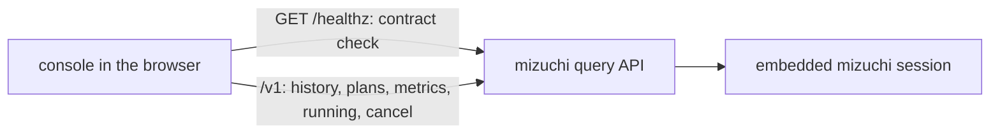

# mizuchi-console

**See what a mizuchi engine ran: query history, plans, operator metrics, and live queries with cancel.**

[](https://github.com/Sannrox/mizuchi-console/actions/workflows/ci.yml)
[](https://github.com/Sannrox/mizuchi-console/releases)
[](LICENSE)

[Try it](#try-it) · [How it works](#how-it-works) · [Releasing](RELEASING.md) · [Changelog](CHANGELOG.md) · [Decisions](docs/decisions/README.md)

The web console for the [mizuchi](https://github.com/Sannrox/mizuchi) query
engine. It is a client of mizuchi's versioned HTTP API and nothing else
([ADR 0002](docs/decisions/0002-separate-console-api-only.md)): it never links
engine code, and mizuchi itself ships no UI. A static bundle served next to the
API shows what the engine ran and what is running now.

- **The whole life of a query.** History with filters, the plan with an EXPLAIN
  ANALYZE overlay, per-operator metrics and memory, and a polled running list
  with cancel.
- **One contract, checked at startup.** Built against mizuchi's
  `mizuchi.query-api/v1` contract; the console requires `/healthz` to list it
  and shows "too old for this console" instead of failing strangely.
- **Generated types, never hand-edited.** `src/api/mizuchi.gen.ts` is generated
  from the vendored schema, and CI fails when it is stale.
- **Works behind any prefix.** The bundle uses only relative URLs and loads
  nothing from other origins, so the same zip serves at `/ui/` and behind a
  proxy prefix.
- **Pin one release.** Each signed tag publishes a reproducible zip,
  `SHA256SUMS`, an SBOM, and provenance attestations; an embedding server pins
  one by URL and SHA-256.
- **Tokens stay in memory.** The optional bearer token is held in memory only,
  never written to storage.

## Try it

From a fresh clone (Node 26 and pnpm, as in CI):

```sh
git clone https://github.com/Sannrox/mizuchi-console && cd mizuchi-console
pnpm install
MIZUCHI_URL=http://127.0.0.1:8080 pnpm dev
```

```text
  VITE v8.3.1  ready in 711 ms

  ➜  Local:   http://localhost:5173/
```

The dev server proxies `/v1` and `/healthz` to the mizuchi server at
`MIZUCHI_URL`. Without one running, the console loads and reports that it
cannot reach the engine; for real data, point `MIZUCHI_URL` at a mizuchi
embedder with the engine's query API enabled.

Build the production bundle and the pinnable zip:

```sh
pnpm build                        # dist/
VERSION=v0.0.0-dev pnpm package   # release/mizuchi-console-v0.0.0-dev.zip + SHA256SUMS
```

## How it works



In production, a server embedding mizuchi serves the unpacked release zip at
`/ui/` (the query API's `ui_dir`, mizuchi ADR 0014), so the console and the
API share one origin and the bundle finds the API by relative URL. At startup
the console requires `/healthz` to list `mizuchi.query-api/v1`, the contract
it was built for, and gates every screen on that check. Anything the console
shows or does is also available to any other API client; a screen that needs
new data starts with an API change in mizuchi (ADR 0002).

## API types

`api/mizuchi-http-v1.schema.json` is mizuchi's published query-api schema, vendored at
the commit in `api/MIZUCHI_REF`. `src/api/mizuchi.gen.ts` is generated from it.

```sh
pnpm api:sync <mizuchi-commit-sha>   # update the vendored schema and regenerate
pnpm api:check                       # CI: fail when generated types are stale
```

## How it ships

Each signed annotated tag `vX.Y.Z` (equal to the `package.json` version) publishes
`mizuchi-console-vX.Y.Z.zip`, `SHA256SUMS`, an SBOM, provenance attestations, a
family release manifest, and a GitHub Release whose notes come from CHANGELOG.
mizuchi serves an unpacked zip from `QueryApiConfig.ui_dir` at `/ui/` (ADR 0014).
This repository does not publish a container image. See [RELEASING.md](RELEASING.md).

## Develop

```sh
pnpm install
MIZUCHI_URL=http://127.0.0.1:8080 pnpm dev   # proxies /v1 and /healthz to a mizuchi server
pnpm api:check && pnpm typecheck && pnpm lint && pnpm format:check && pnpm test && pnpm build
VERSION=v0.0.0-dev pnpm package              # release/ zip + SHA256SUMS
```

Stack: TypeScript (strict), React, Vite, TanStack Query and Router, Tailwind,
Oxlint (type-aware) and Oxfmt, Vitest, pnpm. Agent workflow: [AGENTS.md](AGENTS.md).
License: Apache-2.0.
